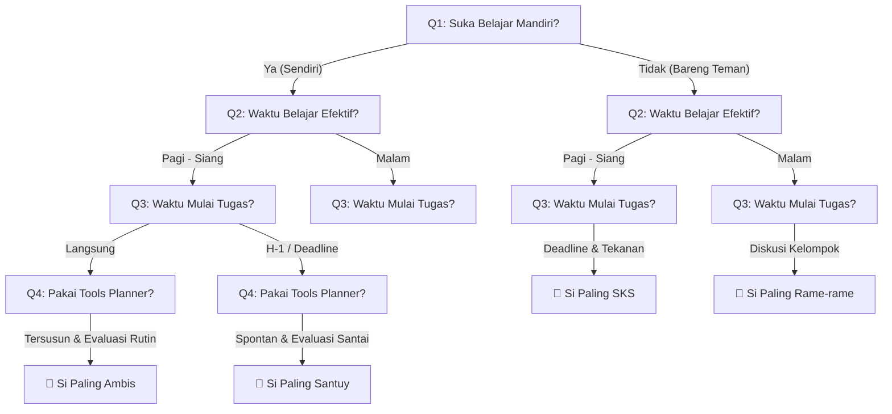

# 🎓 Student Study Type Classifier

> **Klasifikasi Tipe Mahasiswa Berdasarkan Kebiasaan Belajar Menggunakan Struktur Data Binary Decision Tree**

[](https://www.python.org/)
[](https://streamlit.io/)
[](#analisis-struktur-data--algoritma)
[](#4-menjalankan-unit-testing)

---

## Latar Belakang & Ringkasan Proyek

Setiap mahasiswa memiliki pola, waktu produktif, dan metode belajar yang unik. Sebagian lebih efektif belajar mandiri dengan jadwal terstruktur, sementara lainnya lebih optimal melalui diskusi kelompok atau bekerja di bawah tekanan tenggat waktu (*deadline*).

Proyek ini dikembangkan untuk mengimplementasikan struktur data **Binary Decision Tree** ke dalam sebuah aplikasi web interaktif yang mampu:
1. Melakukan klasifikasi karakter belajar mahasiswa melalui penelusuran pohon biner (*tree traversal*) berdasarkan 5 dimensi kebiasaan belajar.
2. Mengelompokkan pengguna ke dalam 4 tipe persona mahasiswa:
   - 🐜 **Si Paling Ambis** — Disiplin, terstruktur, dan visioner.
   - 🐨 **Si Paling Santuy** — Tenang, fleksibel, dan minim stres.
   - 🦉 **Si Paling SKS** — Fokus tinggi di bawah tekanan sistem kebut semalam.
   - 🐬 **Si Paling Rame-rame** — Pembelajar sosial, kolaboratif, dan komunikatif.
3. Menyajikan **rekomendasi strategi belajar personal**, analisis kekuatan serta titik perhatian, teknik belajar (*Active Recall*, *Feynman*, *Pomodoro*, *Jigsaw*), hingga rekomendasi tools produktivitas yang relevan.
4. Memvisualisasikan langkah penelusuran jalur pohon (*Decision Path Breakdown*) secara transparan dari simpul akar (*root*) hingga simpul daun (*leaf*).

---

## Analisis Struktur Data & Algoritma

### 1. Representasi Pohon Biner (*Binary Tree*)
Struktur pohon dibangun secara berorientasi objek (*Object-Oriented Programming*) menggunakan kelas `TreeNode`:

```python
class TreeNode:
    def __init__(self, feature=None, left=None, right=None, value=None):
        self.feature = feature  # Fitur pertanyaan (internal node)
        self.left = left        # Cabang Kiri (kondisi True / Pilihan 1)
        self.right = right      # Cabang Kanan (kondisi False / Pilihan 2)
        self.value = value      # Label hasil klasifikasi (leaf node)

    def is_leaf(self):
        return self.value is not None
```

### 2. Kompleksitas Algoritma

| Aspek | Kompleksitas | Penjelasan |
| :--- | :---: | :--- |
| **Waktu Penelusuran (*Time Complexity*)** | $\mathcal{O}(d)$ | Penelusuran bergerak dari *root* ke *leaf* sejauh kedalaman pohon ($d = 5$), dengan 1 perbandingan biner pada setiap tingkat. |
| **Ruang Memori (*Space Complexity*)** | $\mathcal{O}(1)$ | Penelusuran dilakukan secara iteratif menggunakan perulangan `while` tanpa tambahan *call stack* rekursi. |
| **Kapasitas Daun (*Total Leaves*)** | $2^5 = 32$ | Mencakup seluruh kemungkinan kombinasi jawaban dari 5 pertanyaan biner. |

---

## Diagram Alur Keputusan (*Decision Tree*)



---

## Struktur Repositori

```text
student-study-type-classifier/
│
├── .streamlit/
│   └── config.toml        # Konfigurasi tema gelap Streamlit
├── .gitignore             # Daftar file/folder yang diabaikan Git
├── app_web.py             # Antarmuka aplikasi web interaktif berbasis Streamlit
├── tree_model.py          # Implementasi kelas TreeNode, pembangunan tree, dan classify_student()
├── recommendations.py     # Basis pengetahuan persona, kekuatan, teknik belajar, dan tools
├── test_tree.py           # Pengujian unit otomatis menggunakan modul unittest Python
├── requirements.txt       # Daftar dependensi pustaka Python
└── README.md              # Dokumentasi proyek
```

---

## Panduan Menjalankan Aplikasi

### 1. Prasyarat Sistem
Pastikan **Python 3.9+** sudah terpasang pada sistem Anda.

### 2. Kloning Repositori & Instalasi Dependensi
```bash
git clone https://github.com/Rahma-183/student-study-type-classifier.git
cd student-study-type-classifier
pip install -r requirements.txt
```

### 3. Menjalankan Aplikasi Web (Streamlit)
```bash
streamlit run app_web.py
```
Aplikasi akan berjalan secara lokal dan terbuka di peramban pada alamat `http://localhost:8501`.

### 4. Menjalankan Unit Testing
Untuk memverifikasi integritas struktur pohon dan seluruh skenario pengujian klasifikasi:
```bash
python test_tree.py
```
Output pengujian:
```text
......
----------------------------------------------------------------------
Ran 6 tests in 0.001s

OK
```

---

## Teknologi yang Digunakan
* **Bahasa Pemrograman:** Python 3
* **Antarmuka Web:** Streamlit (dengan kustomisasi CSS *Dark Violet Glassmorphism*)
* **Pengujian:** Python Built-in `unittest`

---

## Konteks Akademik
Dikembangkan sebagai proyek akhir mata kuliah **Struktur Data dan Algoritma (SDA)** dengan fokus pada penerapan praktis struktur data *Binary Tree* dan arsitektur kode modular.
